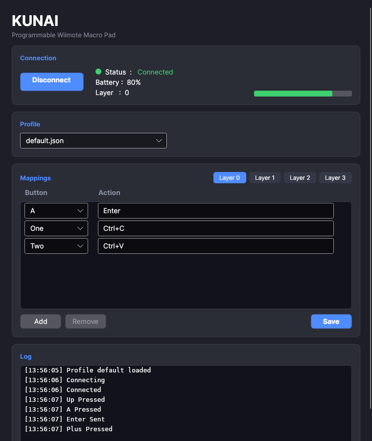

# KUNAI — Programmable Wiimote Macro Pad

Nintendo Wii Remote を、プログラマ向けの **左手デバイス**(マクロパッド)にするクロスプラットフォームアプリです。
QMK のレイヤー、Stream Deck のアクション、TourBox の片手操作の考え方を、安価で入手しやすい Wii Remote で実現します。

- Windows 11 / Ubuntu 22.04+ / Xubuntu 22.04+ / Debian 系 Linux(X11 優先)
- .NET 8 LTS + Avalonia 11(MVVM は CommunityToolkit.Mvvm、ReactiveUI は不使用)
- プロファイルは JSON。ショートカット、OS 機能、マクロ(`Delay` 対応)を割り当て可能



*メイン画面(Wii Remote の接続と操作を模擬した状態で描画した画像で、実機のキャプチャではありません)*

## レイヤー

B と Home を押している間だけ切り替わる、QMK 風のモメンタリーレイヤーです。離すと元のレイヤーへ戻ります。

| レイヤー | 条件 | 例: A | 例: 1 | 例: 2 |
|---|---|---|---|---|
| Layer 0 | 通常 | `Enter` | `Ctrl+C` | `Ctrl+V` |
| Layer 1 | B 押下中 | `Ctrl+Z` | `Ctrl+Shift+Z` | `Ctrl+X` |
| Layer 2 | Home 押下中 | `Alt+Tab` | `Win+D` | `BrowserBack` |
| Layer 3 | B + Home 押下中 | `LaunchTerminal` | `LaunchBrowser` | `LockScreen` |

B と Home は **レイヤー切替専用**で、アクションは割り当てられません(JSON に書いても無視されます)。

## ビルドと実行

必要なもの: [.NET 8 SDK](https://dotnet.microsoft.com/download/dotnet/8.0)

```bash
dotnet build                       # ソリューション全体
dotnet test                        # 単体テスト(361 件)
dotnet run --project src/KUNAI.UI  # 起動(デスクトップ環境が必要)

# 配布用(フレームワーク依存。実行先に .NET 8 Runtime が必要)
dotnet publish src/KUNAI.UI -c Release -r linux-x64 --self-contained false -o out/linux
dotnet publish src/KUNAI.UI -c Release -r win-x64   --self-contained false -o out/win
```

## システムトレイへの常駐

KUNAI はシステムトレイ(通知領域)に常駐します。

- ウィンドウを **閉じる(×)** か **最小化** すると、ウィンドウが非表示になります(接続とキー送出は続きます)
- トレイアイコンの **クリック**、またはメニューの **Show KUNAI** でウィンドウを再表示します
- トレイのメニュー: **Show KUNAI** / **Connect(Disconnect)** / **Exit**
- **終了はトレイメニューの Exit** から行います(終了時にプロファイルを自動保存します)
- アイコンにカーソルを合わせると、接続状態と電池残量が表示されます
- アイコン右下の丸の色が接続状態を表します(**赤**=切断 / **黄**=接続中 / **緑**=接続済み。画面の状態色と同じ)

### Linux のトレイ

KUNAI は、実行環境に合わせて次の順にトレイの方式を選びます。

1. **XEmbed**(従来型のトレイ): Xfce の通知領域(Status Tray)、Enlightenment の Systray、KDE(X11)など
2. **StatusNotifierItem**(SNI): KDE、GNOME(AppIndicator 拡張)、SNI 対応のパネルなど
3. どちらも無ければ、トレイ常駐はせず、ウィンドウを閉じるとアプリが終了します(ウィンドウに戻れなくなるのを防ぐため)

選ばれた方式は、アプリ起動直後のログに `System tray: XEmbed`(または `StatusNotifierItem`)と出ます。
トレイが見つからないときは `No system tray found ...` と出ます。

XEmbed 方式では、次の点が他の方式と違います。
- 右クリックで出るメニューは、KUNAI 独自の簡易メニューです(Show KUNAI / Connect(Disconnect)/ Exit)
- ツールチップは表示されません(接続状態はアイコン右下の丸の色で分かります)

方式を指定したいとき(環境変数 `KUNAI_TRAY`)と、トレイを使わないとき:

```bash
KUNAI_TRAY=xembed ./KUNAI.UI    # XEmbed を使う(使えなければトレイ無し)
KUNAI_TRAY=sni ./KUNAI.UI       # StatusNotifierItem を使う
KUNAI_TRAY=none ./KUNAI.UI      # トレイを使わない(閉じるとアプリが終了)
./KUNAI.UI --no-tray            # 同上
```

> Xfce でアイコンが出ないときは、パネルに「通知領域(Status Tray Plugin)」が追加されているか確認してください。
> Enlightenment では、シェルフに「Systray」ガジェットを追加してください。

## Wii Remote の接続

アプリの「Connect」は、OS に **接続済み(ペアリング済み)** の Wii Remote を最大 20 秒間探します。
先に OS 側の Bluetooth でペアリングしてください。

### Windows 11(自動ペアリング)
Windows の標準 UI では、Wii Remote のペアリングで PIN(Bluetooth アドレスのバイナリ値)を求められ、手入力できません。
KUNAI は **Connect を押すと自分でペアリングします**。

1. KUNAI の **Connect** を押す(最大 30 秒間、探索とペアリングを繰り返します)
2. Wii Remote の **1 と 2 を同時押し** して、LED を点滅させる(点滅の間、押し続けなくても構いませんが、数秒で消えるので Connect の直後に押す)
3. ログに `Wii Remote found` → `Wii Remote paired` → `Connected` と出れば完了

- 事前に Windows の Bluetooth をオンにしておくこと。Windows 側で Wii Remote を手動ペアリングする必要はありません(以前の失敗した登録が残っていれば、KUNAI が削除して作り直します)。
- 失敗したときは、ログの `Pairing failed (error N)` を確認し、Wii Remote を 1+2 で再度点滅させてください。
- 一部の Bluetooth アダプターは Wii Remote を HID として認識しないことがあります。
- Windows 実機でペアリングに成功したことを確認済みです(利用者による報告)。

### Linux(自動接続)
Connect を押して Wii Remote の **1 と 2 を同時押し** するだけです。KUNAI が `bluetoothctl` で探索し、
BlueZ のペアリング(PIN 認証)を経由せず **L2CAP で直接接続** します(Wii Remote は HID チャネルへの接続に認証を要求しません)。

1. Bluetooth をオンにし、`bluez`(`bluetoothctl`)をインストールしておく
2. KUNAI の **Connect** を押し、すぐに Wii Remote の 1 と 2 を同時押しして LED を点滅させる
3. ログに `Wii Remote found` → `Wii Remote connected` → `Connected` と出れば完了

- OS 側で手動ペアリングする必要はありません。すでに `hid-wiimote` 経由で接続済みなら、そちらを優先して使います。
- 探索は 1 回約 6 秒で、30 秒間繰り返します。
- Linux 実機で接続に成功したことを確認済みです(利用者による報告)。

## Linux の権限設定(uinput / hidraw)

キー送出は `/dev/uinput` に仮想キーボードを作って行うため、一般ユーザーに権限が必要です。
権限が無いと、ログに `Cannot open /dev/uinput (Permission denied)` と設定手順が出ます(アプリは落ちません)。

```bash
sudo cp tools/linux/99-kunai.rules /etc/udev/rules.d/
sudo udevadm control --reload-rules && sudo udevadm trigger
sudo usermod -aG input "$USER"     # 再ログインが必要
sudo modprobe uinput
```

- 最初のキー送出時に仮想デバイスを作るため、**最初の 1 回だけ約 0.3 秒遅れます**。
- uinput はカーネル層で動くので、X11 でも Wayland でも使える見込みです(Wayland は未検証)。
- 画面ロックは `loginctl lock-session`(→ `xdg-screensaver lock` → `xflock4`)です。デスクトップ環境が反応しない場合は、実際にロックされない可能性があります。

## プロファイル

起動時に自動ロードし、終了時に自動保存します(切り替え時も、編集中の内容を自動保存します)。

| OS | 保存先 |
|---|---|
| Linux | `~/.config/KUNAI/profiles/` |
| Windows | `%APPDATA%\KUNAI\profiles\` |

初回起動時、保存先が空なら同梱の `default` / `coding` / `writing` / `browser` がコピーされます。

```json
{
  "name": "coding",
  "layers": [
    {
      "layerNumber": 0,
      "mappings": [
        { "button": "A",    "action": "Enter" },
        { "button": "One",  "action": "Ctrl+C" },
        { "button": "Plus", "action": "", "macro": ["Ctrl+S", "Delay(300)", "Alt+Tab"] }
      ]
    }
  ]
}
```

- `button`: `A` `One` `Two` `Plus` `Minus` `Up` `Down` `Left` `Right`(`B` と `Home` は不可)
- `action`: ショートカットまたは標準アクション名
- `macro`: 指定すると `action` より優先されます。`Delay(ミリ秒)` で待機(0〜60000)
- 画面の Action 欄では、マクロを `Ctrl+S; Delay(300); Alt+Tab` のようにセミコロン区切りで入力します

### ショートカット
`Ctrl+Shift+T` のように `+` でつなぎます(大文字小文字は区別しません)。

- 修飾キー: `Ctrl` `Shift` `Alt` `Win`(`Super` / `Meta` / `Cmd` も同じ)
- キー: `A`〜`Z`、`0`〜`9`、`F1`〜`F12`、`Enter` `Escape` `Tab` `Space` `Backspace` `Delete` `Insert`、
  `Home` `End` `PageUp` `PageDown`、`Up` `Down` `Left` `Right`、記号(`- = , . / \ ; ' [ ] \``)、
  `BrowserBack` `BrowserForward` `BrowserRefresh` `BrowserHome`、`VolumeUp` `VolumeDown` `VolumeMute`、
  `MediaPlayPause` `MediaNext` `MediaPrevious`、`PrintScreen`

### 標準アクション
| 名前 | Windows | Linux |
|---|---|---|
| `LaunchBrowser` | 既定ブラウザで URL を開く | `xdg-open <URL>` |
| `LaunchTerminal` | `wt.exe` → `powershell.exe` → `cmd.exe` | `x-terminal-emulator` → `gnome-terminal` → `konsole` → `xfce4-terminal` → `xterm` |
| `VolumeUp` / `VolumeDown` / `Mute` | メディアキー送出 | `pactl`(±5%)。無ければメディアキー |
| `LockScreen` | `LockWorkStation` | `loginctl lock-session` ほか |
| `BrowserBack` / `BrowserForward` | ブラウザキー送出 | `Alt+←` / `Alt+→` |

標準アクション名はショートカットより優先されます(`BrowserBack` は標準アクションとして扱われます)。

## アーキテクチャ

```
KUNAI.UI (Composition Root / Avalonia / MVVM)
   ├─→ KUNAI.Input            HidSharp による Wii Remote 接続          ─┐
   ├─→ KUNAI.Actions          ActionExecutor / MacroExecutor            ├─→ KUNAI.Core（参照ゼロ）
   ├─→ KUNAI.Platform.Windows SendInput / LockWorkStation               │    ドメイン・抽象・LayerManager
   └─→ KUNAI.Platform.Linux   uinput / xdg-open / pactl / loginctl     ─┘    ProfileRepository 等
```

Core は Platform を参照せず、抽象(`ISyntheticKeyboard`, `ISystemActions`, `IWiimoteService` など)だけを持ちます。
実装は UI の `Program.cs`(DI)で OS に応じて結び付けます。
詳細は [docs/architecture.md](docs/architecture.md) と [docs/class-diagram.md](docs/class-diagram.md) を参照。

## 検証状況

| 項目 | 状況 |
|---|---|
| ビルド(Linux)/ publish(linux-x64, win-x64) | 確認済み |
| 単体テスト 361 件(行カバレッジ 約 79%) | 合格 |
| 画面描画(ヘッドレス)・DI 解決・プロファイル読み書き | 確認済み |
| Wii Remote の自動ペアリング・接続(Windows / Linux) | **確認済み**(利用者による報告) |
| Wii Remote のボタン読み取り(Windows / Linux) | **確認済み**(利用者による報告) |
| Wii Remote の電池取得 | **未検証**(Fake の転送層でのみテスト) |
| Windows `SendInput` によるキー送出 | **確認済み**(利用者による報告) |
| Windows `LockWorkStation` | **未検証**(イベント列・構造体サイズのみテスト) |
| Linux `uinput` への実書き込み(キー送出) | **確認済み**(利用者による報告) |
| Linux のブラウザ/端末/音量/ロックの外部コマンド | **未検証**(起動コマンドと引数のみテスト) |
| 実ウィンドウでの操作(マウス・キーボード) | **未検証** |
| システムトレイのアイコン・メニュー・接続状態の色(Windows / Linux) | **確認済み**(利用者による報告) |

## 既知の制限と今後

- Wii Remote を **横持ち**にした場合の十字キー回転は未対応(本体の物理位置どおり)
- 1 台のみ対応(複数台の同時接続は未対応)
- Wayland 専用の対応、アプリ別プロファイル自動切替、Nunchuk / MotionPlus、振る・傾けるジェスチャー、ダブルタップは将来拡張
  (インターフェースは `IGestureRecognizer` のみ定義済み)
- ログの最大件数は 1000 件、Delay は 1 回あたり最大 60 秒

## ライセンス

[MIT License](LICENSE)
